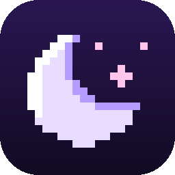
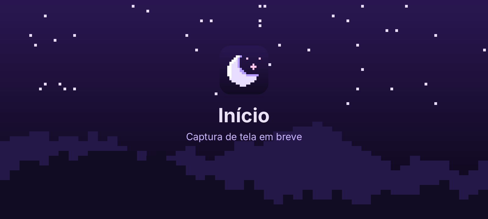
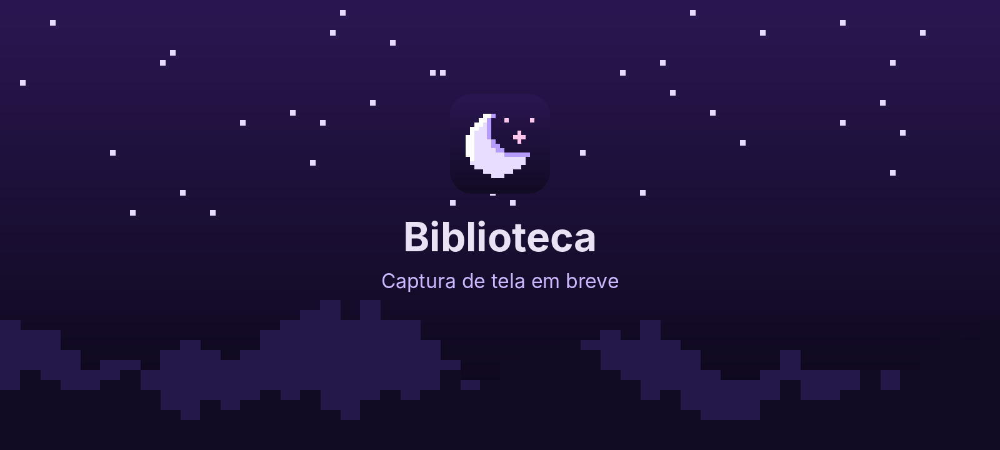
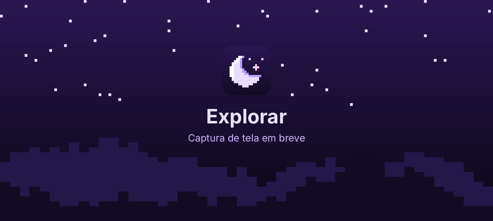
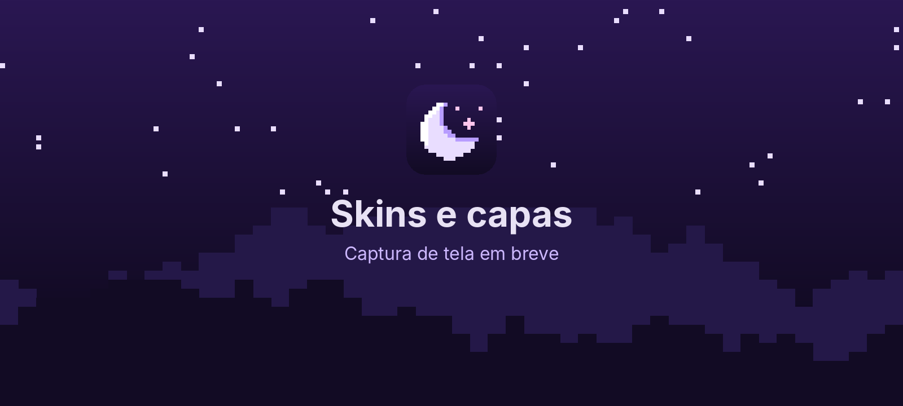

# Noctis Launcher

**Minecraft: Java Edition no Android, sob a luz da lua.**

Um launcher feito para o celular deitado: leve, otimizado e com cara de noite estrelada.

### [⬇️ Baixar a versão mais recente](https://github.com/frostkl4/Launcher-minecraft-1-Mobile/releases/latest)

> [!NOTE]
> O Noctis Launcher é uma **versão modificada não oficial** do [Zalith Launcher 2](https://github.com/ZalithLauncher/ZalithLauncher2), de MovTery e colaboradores (baseada no commit `3ad5a78`).
> Não é afiliado ao Zalith Launcher, à Mojang Studios nem à Microsoft.

---

## 🌙 Sobre o projeto

Quando o celular deita, a noite começa. O **Noctis Launcher** leva o Minecraft: Java Edition para o Android com uma interface pensada para a tela na horizontal: tudo fica ao alcance do polegar, sem menus escondidos e sem desperdiçar a pouca altura que o celular tem nessa posição.

Por baixo do céu estrelado está o motor do Zalith Launcher 2, com ajustes de desempenho para que o jogo tenha toda a memória e o processador que o aparelho pode dar.

- **Deitado de verdade:** barra lateral de navegação, cartões de instâncias em grade e o botão Jogar sempre à vista.
- **Leve:** o céu, a lua e as paisagens são desenhados em vetor e pixel art gerada na hora, sem imagens pesadas na memória.
- **Otimizado:** perfil de Java automático conforme a RAM do celular, e o launcher se fecha sozinho enquanto o jogo roda.

---

## ✨ Funcionalidades

### 🏰 Interface
- Barra lateral com ícones em pixel art: **Início, Biblioteca, Explorar, Skins, Multiplayer e Configurações**.
- Tela inicial com o destaque **"Continuar jogando"**: botão Jogar, memória do jogo, configurações e pasta da instância num toque.
- **Grade de instâncias** com busca, filtro por loader (Forge, NeoForge, Fabric, Quilt, Vanilla) e menu ao segurar o cartão.
- Tema **Noctis**: roxo noturno, lua e montanhas. Também aceita papel de parede próprio.

### 👤 Contas, skins e capas
- **Contas Microsoft (originais)**, com skin e capa oficiais.
- **Contas offline**, para jogar sem login (no modo solo e em servidores que aceitam esse tipo de conta).
- **Troca de skin** e prévia **3D** da skin e da capa na tela inicial.
- **Capas para contas offline**: de um arquivo PNG, do **Ely.by** ou do **MinecraftCapes**, aplicadas no jogo pelo servidor de skins local.

### 📦 Downloads integrados
- **Modrinth e CurseForge** no mesmo lugar: modpacks, mods, shaders, pacotes de textura e mundos.
- Ícone oficial de cada projeto, carregado em segundo plano e guardado em cache no celular (o mesmo ícone não é baixado duas vezes).
- Instalação de versões do Minecraft com **Forge, NeoForge, Fabric, Quilt e OptiFine**.

### ⚡ Desempenho
- **Perfil de JVM automático**: coletor G1 com pausas curtas e limite seguro de RAM conforme a memória do aparelho.
- **Memória liberada durante o jogo**: o jogo roda num processo separado e o launcher se encerra quando ele abre.
- Cache de shaders do Mesa em disco, para os próximos carregamentos serem mais rápidos.
- Logs enxutos: só avisos, erros e o log do jogo (o que importa para descobrir um crash).

---

## 📸 Capturas de tela

<!--
  Para trocar uma imagem: no GitHub, abra a pasta docs/screenshots,
  toque em "Add file" → "Upload files" e envie um arquivo com o MESMO nome
  (inicio.png, biblioteca.png, explorar.png ou skins.png). Ele substitui o atual.
  Dica: capturas do celular deitado (paisagem) ficam melhores.
-->

<table>
  <tr>
    <td align="center"> <b>Início</b></td>
    <td align="center"> <b>Biblioteca</b></td>
  </tr>
  <tr>
    <td align="center"> <b>Explorar</b></td>
    <td align="center"> <b>Skins e capas</b></td>
  </tr>
</table>

---

## 📲 Instalação

### Requisitos
| | Mínimo | Recomendado |
|---|---|---|
| **Android** | 8.0 | 10 ou mais novo |
| **Memória RAM** | 3 GB | 4 GB ou mais (para modpacks) |
| **Espaço livre** | 1 GB | 4 GB ou mais (modpacks e mundos) |
| **Processador** | ARM 32 ou 64 bits | ARM 64 bits |

### Passo a passo
1. Abra a página de **[Releases](https://github.com/frostkl4/Launcher-minecraft-1-Mobile/releases/latest)** pelo celular.
2. Em **Assets**, baixe o arquivo certo para o seu aparelho:
   - `NoctisLauncher-vX.Y.Z-arm64.apk`: **quase todos os celulares** dos últimos anos.
   - `NoctisLauncher-vX.Y.Z-arm.apk`: celulares antigos ou de 32 bits.
3. Toque no arquivo baixado. Se o Android pedir, permita **"Instalar apps desconhecidos"** para o navegador ou o gerenciador de arquivos.
4. Abra o Noctis. Na primeira vez ele prepara os componentes do Java; espere terminar.
5. Toque no chip de conta, no canto superior direito, e entre com sua conta Microsoft ou crie uma conta offline.
6. Em **Explorar**, instale uma versão do Minecraft ou um modpack.
7. Volte ao **Início** e toque em **Jogar**. 🌙

> [!TIP]
> O APK vem pronto: **não precisa descompactar nada**. Na dúvida entre os dois arquivos, baixe o `arm64`; se o Android disser que o app não é compatível, use o `arm`.

### Atualizar
Baixe o APK novo e instale **por cima** do atual. Instâncias, mundos, contas e configurações continuam no lugar.

### Problemas comuns
- **"App não instalado"**: o download ficou incompleto ou o arquivo não é o do seu processador. Baixe de novo ou troque `arm64` por `arm`.
- **CurseForge pede uma chave de API**: crie uma chave grátis em [console.curseforge.com](https://console.curseforge.com) e cole em **Configurações → Launcher → Chave de API do CurseForge**. Ela fica salva só no seu aparelho. Sem chave, a busca abre no Modrinth.
- **O jogo fecha ao abrir**: diminua a memória no botão de memória da tela inicial e tente de novo. O log do jogo fica nas configurações da instância (segure o cartão → **Configurar instância**); envie-o junto com o relato do problema.

---

## 🛠️ Compilar você mesmo (dá para fazer só pelo celular)

O GitHub compila o app sozinho, sem precisar de PC:

- **A cada envio** de código, o workflow **Build CI** gera um APK de teste (`debug`) para arm64 na aba **Actions**.
- **A cada tag** no formato `vX.Y.Z`, o workflow **Release** gera os APKs oficiais assinados e os publica em **Releases**.

<b>Configuração para publicar versões (mantenedores)</b>

Secrets do repositório em **Settings → Secrets and variables → Actions**:

| Secret | Obrigatório | Para quê |
|---|---|---|
| `NOCTIS_KEYSTORE_BASE64` | Sim | Chave de assinatura (PKCS12) em Base64 |
| `NOCTIS_KEYSTORE_PASSWORD` | Sim | Senha da chave |
| `OAUTH_CLIENT_ID` | Para login Microsoft | ID de um app registrado no Azure com acesso à API do Minecraft |
| `CURSEFORGE_API_KEY` | Não | Chave do CurseForge embutida no app |

Para publicar: crie a tag `v0.1.0` (pela página de Releases ou por git) e o workflow faz o resto. Em **Actions → Release → Run workflow**, a opção *Only test the build* testa a compilação com uma chave temporária, sem publicar nada.

**Nunca** envie a chave de assinatura nem a senha para o repositório: com elas, qualquer pessoa poderia publicar uma "atualização" falsa do app.

---

## 🙏 Créditos

- **[Zalith Launcher 2](https://github.com/ZalithLauncher/ZalithLauncher2)**, de MovTery e colaboradores: a base de todo o projeto (motor do jogo, contas, downloads, controles e renderizadores).
- **[PojavLauncher](https://github.com/PojavLauncherTeam/PojavLauncher)** e a comunidade de launchers Java para Android, de onde vem o motor do jogo.
- **[Modrinth](https://modrinth.com)** e **[CurseForge](https://www.curseforge.com)**, pelas APIs de conteúdo.
- **[Ely.by](https://ely.by)** e **[MinecraftCapes](https://minecraftcapes.net)**, pelas capas de contas offline.
- As demais bibliotecas e suas licenças estão listadas dentro do app, em **Configurações → Sobre**.

Leia também o README original do Zalith Launcher 2: [English](README_ZALITH_EN_US.md) · [简体中文](README_ZALITH_ZH_CN.md) · [繁體中文](README_ZALITH_ZH_TW.md)

## 📜 Licença

Distribuído sob a **GPL-3.0**, a mesma licença do projeto original (veja [LICENSE](LICENSE)). Os termos adicionais do Zalith Launcher 2 valem para quem redistribuir esta versão: não usar os nomes "ZalithLauncher"/"ZL", informar que é uma versão modificada não oficial e manter os avisos de copyright.

*Minecraft é uma marca da Mojang Studios / Microsoft. O Noctis Launcher não é um produto oficial do Minecraft. Para jogar nos servidores oficiais e apoiar quem faz o jogo, use uma conta original.*

 
Feito sob a luz da lua 🌙

